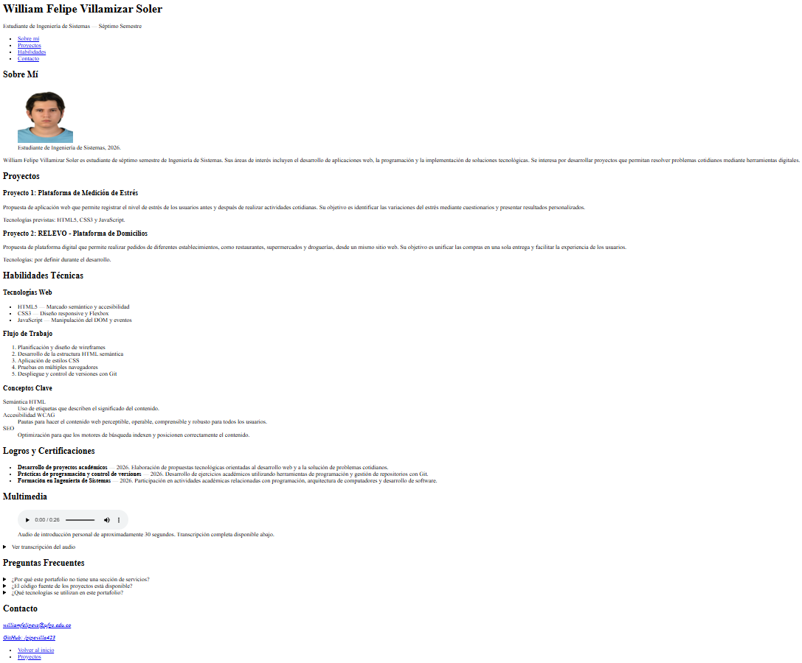
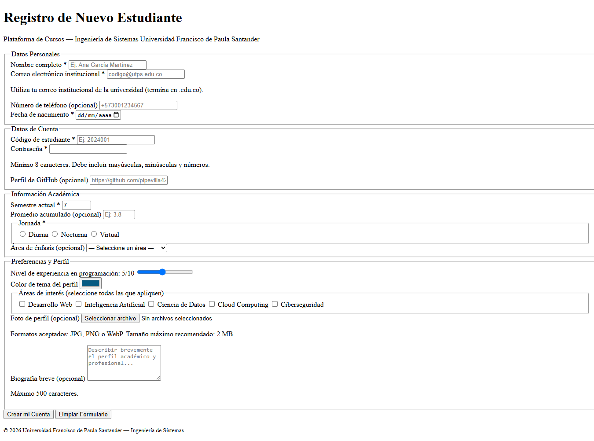

# Post-contenido — Unidad 2: HTML5 Básico

## Información del estudiante

- Nombre: William Felipe Villamizar Soler
- Código: 1152498
- Universidad: Universidad Francisco de Paula Santander
- Programa: Ingeniería de Sistemas
- Semestre: Séptimo
- Asignatura: Programación Web
- Año: 2026

## Descripción

Repositorio correspondiente al laboratorio de la Unidad 2
de Programación Web, desarrollado en séptimo semestre
de Ingeniería de Sistemas.

El proyecto contiene dos partes:

1. Página de portafolio personal con HTML5 semántico.
2. Formulario de registro universitario con validación HTML5.

Ambas partes se encuentran organizadas en carpetas
independientes dentro de un único repositorio Git.

## Parte 1 — Página semántica

La primera parte consiste en el desarrollo de un
portafolio personal utilizando HTML5.

Se implementan los siguientes elementos:

- header: encabezado principal.
- nav: navegación mediante enlaces internos.
- main: contenido principal.
- section: organización de las secciones.
- article: presentación de proyectos.
- aside: información complementaria y habilidades.
- footer: información de contacto.
- figure y figcaption: imagen y descripción.
- ul, ol y dl: diferentes tipos de listas.
- details y summary: preguntas frecuentes.
- mark: resaltado de información importante.
- audio y source: presentación multimedia.
- Metadatos SEO y atributos de accesibilidad.

La página incluye presentación personal, proyectos,
habilidades, logros académicos, introducción en audio,
preguntas frecuentes y datos de contacto.

Archivo principal:
parte-1-pagina-semantica/index.html

## Parte 2 — Formulario de registro

La segunda parte consiste en un formulario de registro
para una plataforma universitaria de cursos.

El formulario está organizado en cuatro grupos:

1. Datos Personales.
2. Datos de Cuenta.
3. Información Académica.
4. Preferencias y Perfil.

Se utilizan 13 tipos diferentes de input HTML5:

- text
- email
- password
- tel
- url
- date
- number
- range
- color
- file
- checkbox
- radio
- hidden

También se utilizan select, optgroup, textarea,
fieldset, legend, label, output y button.

### Validación HTML5

El formulario implementa validación nativa mediante:

- required
- minlength
- maxlength
- min
- max
- step
- pattern
- title
- type

Los campos incorporan etiquetas asociadas mediante
for e id y atributos de accesibilidad como
aria-describedby y autocomplete.

El formulario utiliza method="POST" y
enctype="multipart/form-data" para permitir
el envío de datos y archivos.

La dirección /api/registro corresponde a un
endpoint ficticio utilizado con fines académicos.

Archivo principal:
parte-2-formulario-registro/registro.html

## Decisiones de diseño

### 1. Estructura semántica de Logros y Certificaciones

Se eligió la opción B: lista no ordenada ul,
utilizando elementos li para representar los logros.

Según la sección 2.3 de la guía teórica, un contenido
debe utilizar article cuando tiene sentido por sí
solo fuera del sitio.

En este caso, los logros son descripciones breves
que adquieren mayor sentido al presentarse como parte
de una trayectoria académica completa.

Por esta razón, se decidió utilizar una lista
sin artículos independientes.

### 2. Formato multimedia de introducción personal

Se eligió la opción B: audio con transcripción textual.

El audio permite realizar una introducción personal
mediante archivos MP3 y OGG, fáciles de gestionar.

La transcripción literal se presenta utilizando
details y summary para facilitar el acceso
al contenido sin necesidad de escuchar el audio.

Esta decisión responde al principio Perceptible
de WCAG, ofreciendo una alternativa textual
equivalente a la información auditiva.

### 3. Marcado del campo opcional teléfono

Se eligió la opción A: agregar el texto "(opcional)"
directamente dentro de la etiqueta label.

Esta alternativa permite que todos los usuarios
identifiquen fácilmente el carácter opcional
del campo, sin depender de ayudas adicionales.

También mantiene una presentación clara y
consistente en el formulario.

## Cómo visualizar el proyecto

1. Clonar el repositorio:

   git clone https://github.com/pipevilla423/villamizar-post1-u2.git

2. Abrir la carpeta villamizar-post1-u2
   en Visual Studio Code.

3. Instalar la extensión Live Server.

4. Para visualizar la Parte 1, abrir:
   parte-1-pagina-semantica/index.html

5. Para visualizar la Parte 2, abrir:
   parte-2-formulario-registro/registro.html

6. Hacer clic derecho sobre el archivo HTML
   y seleccionar "Open with Live Server".

7. Verificar los enlaces, las secciones,
   el audio y las validaciones del formulario.

## Pruebas de validación

El formulario permite verificar:

- Campos obligatorios vacíos.
- Formato incorrecto de correo electrónico.
- Contraseñas que no cumplen el patrón.
- Códigos de estudiante con formato inválido.
- Valores numéricos fuera de rango.
- Selección de jornada académica.
- Restauración de valores mediante el botón reset.

Cuando los campos son válidos, el formulario
intenta enviar los datos al endpoint ficticio
/api/registro, que no implementa un registro real.

## Capturas de pantalla

### Parte 1 — Página principal

### Parte 2 — Formulario completo

## Repositorio GitHub

https://github.com/pipevilla423/villamizar-post1-u2

## Autor

William Felipe Villamizar Soler

Ingeniería de Sistemas
Universidad Francisco de Paula Santander
2026

